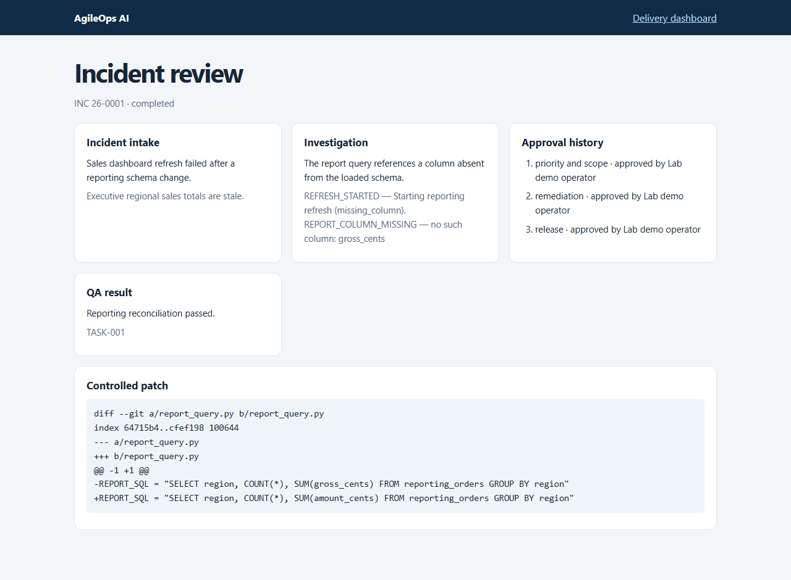

# AgileOps AI

AgileOps AI is a local portfolio project for investigating IT incidents and tracking their resolution. Its demo follows a stale sales dashboard from intake through evidence collection, a controlled SQL repair, independent QA, operator approval, and delivery reporting.

## What runs

- A FastAPI ticket, incident, sprint and backlog API with SQLite persistence and append-only ticket events.
- A reporting ETL lab with five reproducible failure modes and incident-scoped diagnostics.
- Local knowledge retrieval with sentence-transformer embeddings, persisted FAISS, BM25, metadata filters and optional reranking.
- A typed investigator and checkpointed LangGraph workflow that coordinates business analysis, sprint planning, engineering, QA, human approvals and BI.
- A delivery dashboard and a restricted natural language query path backed by verified SQL results.

[Architecture](docs/architecture.md) · [API guide](docs/api.md) · [Agents](docs/agents.md) · [Security](docs/security.md) · [Roadmap](docs/roadmap.md)

## Demo

The synthetic dashboard incident starts with a report query referencing a missing column. The investigator links the error to a current diagnostic and the reporting runbook. The workflow proposes a fix, patches an isolated Git worktree after approval, and reconciles source totals in QA before completing the ticket.



See the [demo walkthrough](docs/demo.md) for the approval and reporting screens.

## Run locally

With Docker Compose, configure the lab operator token in a local `.env` using `.env.example` as a reference, then start the stack.

```sh
docker compose up --build
```

The first start fetches the local model and builds the knowledge index. The API is available at `http://127.0.0.1:8000/docs`. Seed and run the synthetic workflow in the container.

```sh
docker compose exec api python -m agileops.demo --workspace /data --approve-lab
```

For a native run, use Python and Git. Install the optional AI dependencies to run the workflow, FAISS and local models.

```sh
python -m pip install -e ".[dev,ai]"
python -m agileops.demo --workspace tmp/demo --approve-lab
python -m pytest -q
```

Follow the [native demo instructions](docs/demo.md) to open the same data in the API. Run the [reporting lab](docs/reporting-lab.md) on its own to reproduce ETL errors.

## Local model and knowledge search

Run Ollama and pull the configured model. Build the knowledge index once, or rebuild it after changing the runbooks.

```sh
ollama pull qwen2.5:0.5b
python -m agileops.knowledge build
python -m agileops.knowledge search "Why is gross_cents missing?" --system reporting --rerank
python -m agileops.knowledge evaluate --rerank
```

Set `AGILEOPS_OLLAMA_MODEL=qwen2.5:0.5b` to use that tag with the native API. Use `AGILEOPS_OLLAMA_URL` for a different local server. Model weights and local databases stay in your environment.

## Evaluation

Run `python -m agileops.evaluation` for the 60-case investigator benchmark. Add `--all-modes` with a running local model and an index to compare raw LLM, semantic RAG, reranked hybrid RAG and the evidence-grounded investigator. The [evaluation report](docs/evaluation.md) records the measured results, observed failures, and limits of the synthetic cases.

In the measured run, the investigator classified or abstained correctly on all 60 synthetic cases. Hybrid retrieval with reranking achieved Recall@3 of 1.00 and MRR of 0.89 on six labeled questions. The raw and RAG model arms struggled to abstain and cite supporting evidence. See the [milestone verification](docs/milestone-status.md) for the checks behind each stage.
