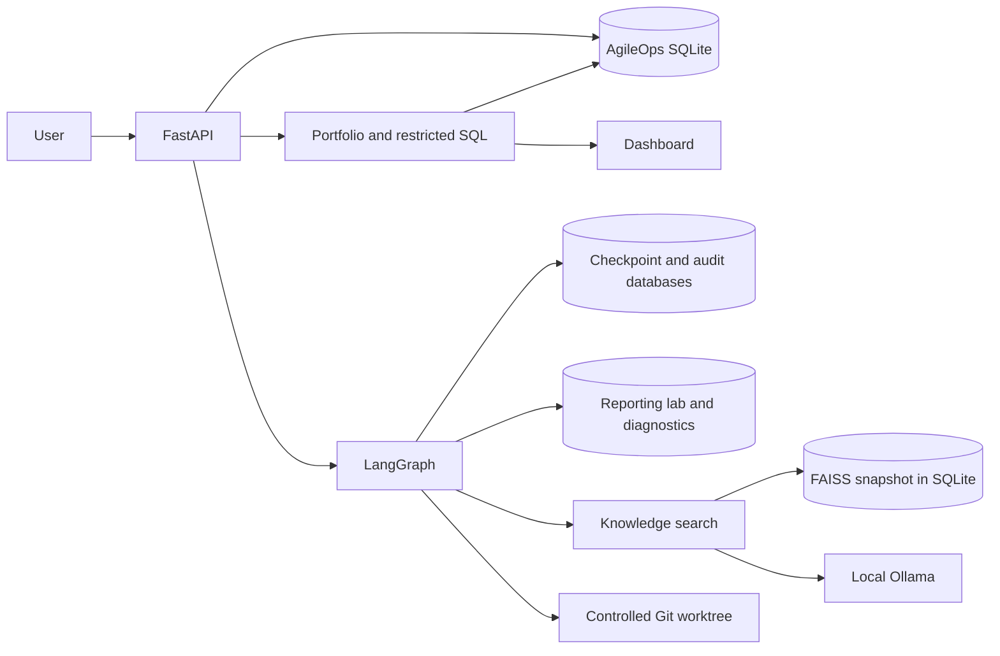
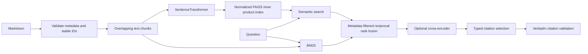
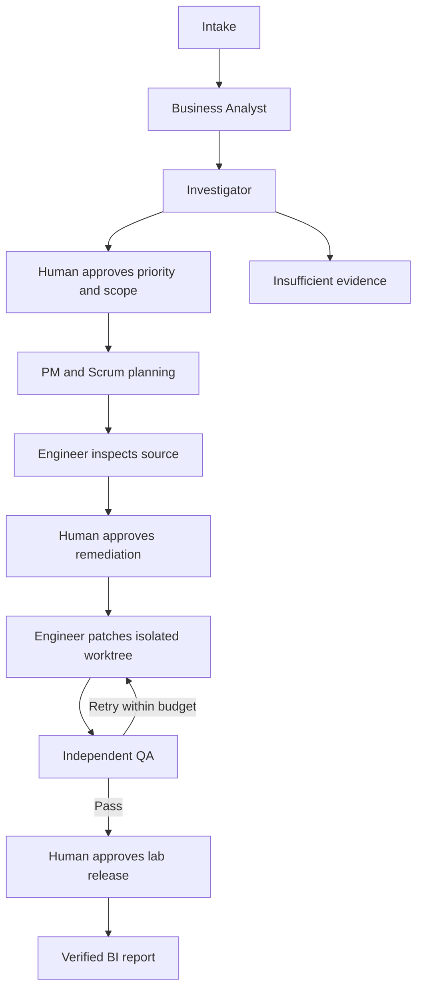

# Architecture

The ticket, incident and sprint APIs use repositories over the application database. Ticket transitions update the snapshot and append a UTC audit event in one transaction. Incident and sprint memberships use foreign keys. An unplanned open ticket appears in the backlog.

The reporting lab uses a separate database. It loads a fixture CSV into staging rows, aggregates totals and records diagnostic events. A failed refresh rolls back its data changes and keeps the prior report. The workflow uses the incident and correlation IDs to retrieve the relevant run.

## Retrieval

The index and chunk metadata are replaced in one SQLite transaction. A query can filter by system, incident type, document type, severity, date range and environment. Keyword, semantic and hybrid modes are available. The investigator can use the packaged runbooks with keyword search if a vector index has not been built.

## Workflow

Checkpoints are keyed by workflow ID in a dedicated SQLite file. An approval must match the pending gate. Dependencies can hold scheduling in the backlog. The automated patch covers the simulated missing-column case. Other supported diagnoses produce evidence and recommendations for manual review.

## Storage

| Database | Tables and views |
| --- | --- |
| Application | `tickets`, `incidents`, `sprints`, `ticket_events`, `ticket_block_events`, analytical views |
| Reporting lab | `reporting_orders`, `reporting_summary`, `reporting_diagnostics` |
| Knowledge | One versioned snapshot of FAISS bytes, embedding model name and source chunks |
| Workflow | LangGraph checkpoints, immutable workflow audit, coordination database |

The API, approval, and storage details are in the [API guide](api.md) and [security notes](security.md).
