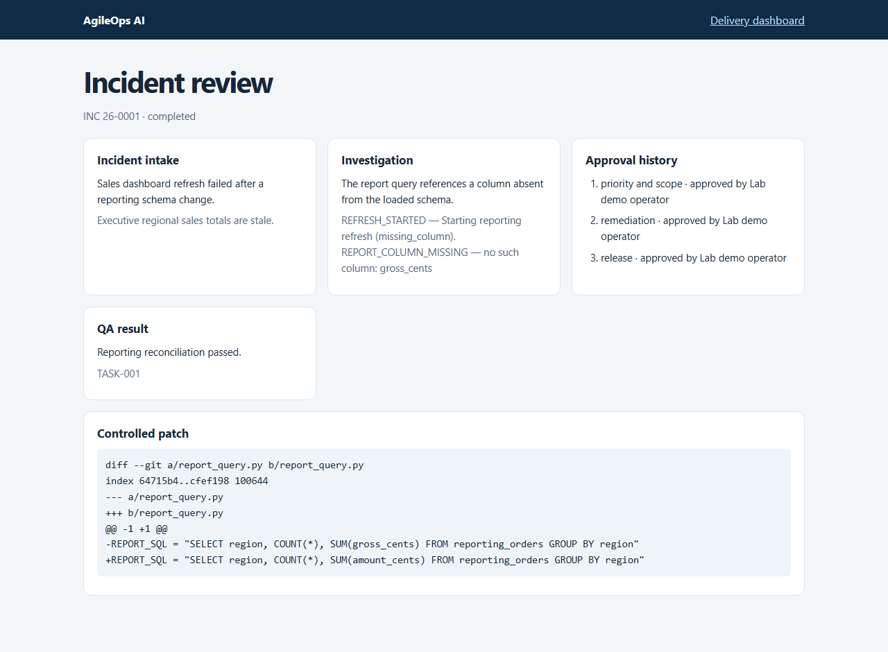
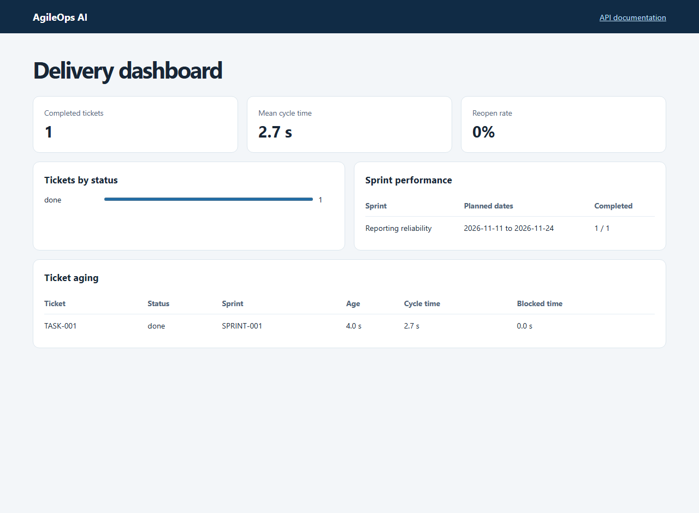

# Demo a dashboard incident

The demo seeds a sales reporting incident, runs a failing refresh, then uses its correlation ID for the investigation. It creates a linked ticket, assigns a sprint, proposes a patch in a controlled Git worktree, runs independent QA, and shows the resulting delivery metrics.

```powershell
python -m pip install -e ".[dev,ai]"
python -m agileops.demo --workspace tmp/demo --approve-lab
```

The `--approve-lab` flag records approvals from a simulated operator for this fixture. To exercise real approval prompts, omit the flag and use the API. Each approval request carries the pending gate, an actor and a reason. The demo reports the database and workflow paths and returns the audit history and restored report as JSON.

Point the application at the same workspace.

```powershell
$env:AGILEOPS_DB_PATH = "tmp/demo/agileops.db"
$env:AGILEOPS_LAB_DB = "tmp/demo/reporting.db"
$env:AGILEOPS_WORKFLOW_DIR = "tmp/demo/workflows"
$env:AGILEOPS_APPROVAL_TOKEN = [guid]::NewGuid().ToString("N")
python -m uvicorn agileops.main:app
```

Open `/workflows/{workflow_id}/review` to inspect the incident intake, evidence, patch, QA result and approvals. Open `/dashboard` for the sprint, ticket aging and throughput view.




